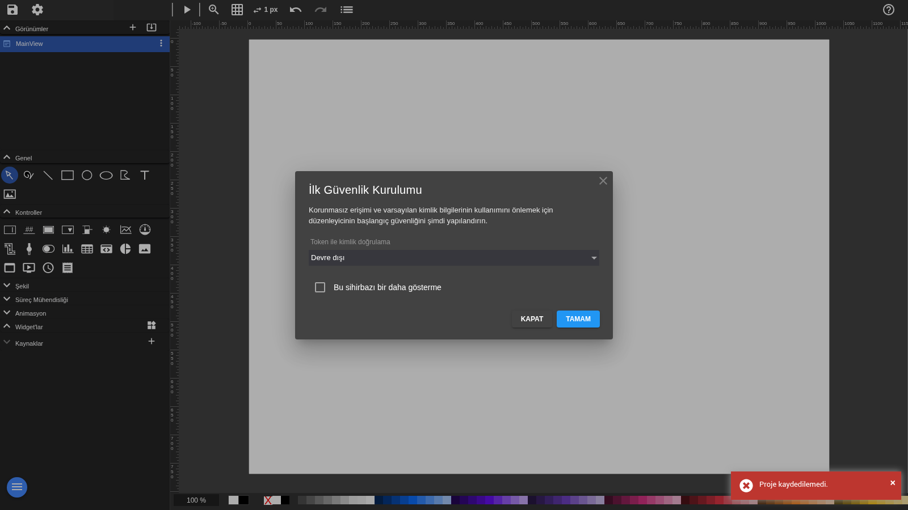
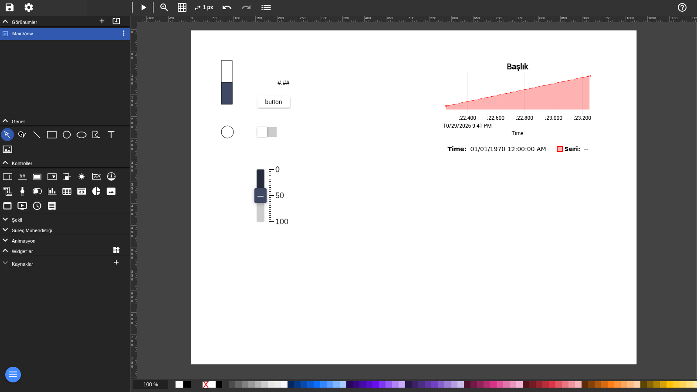
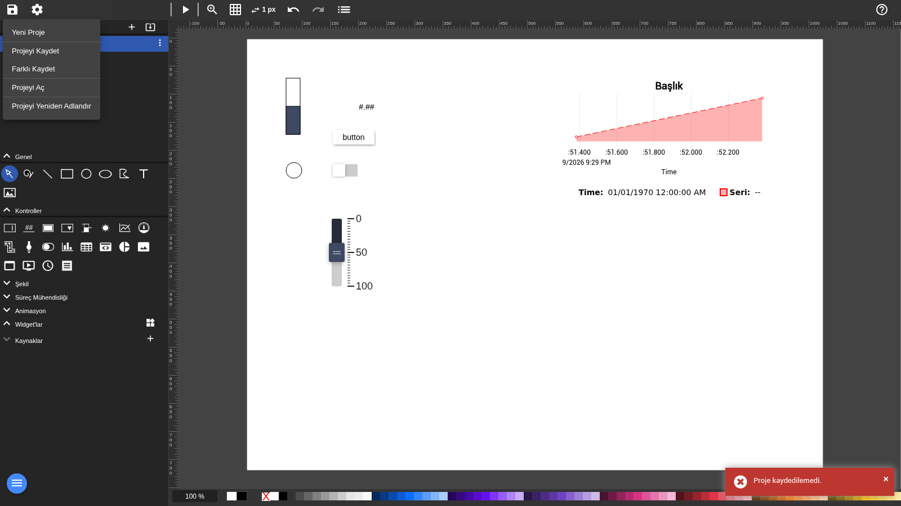
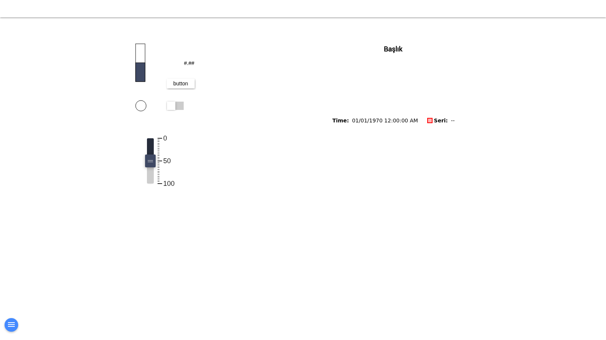
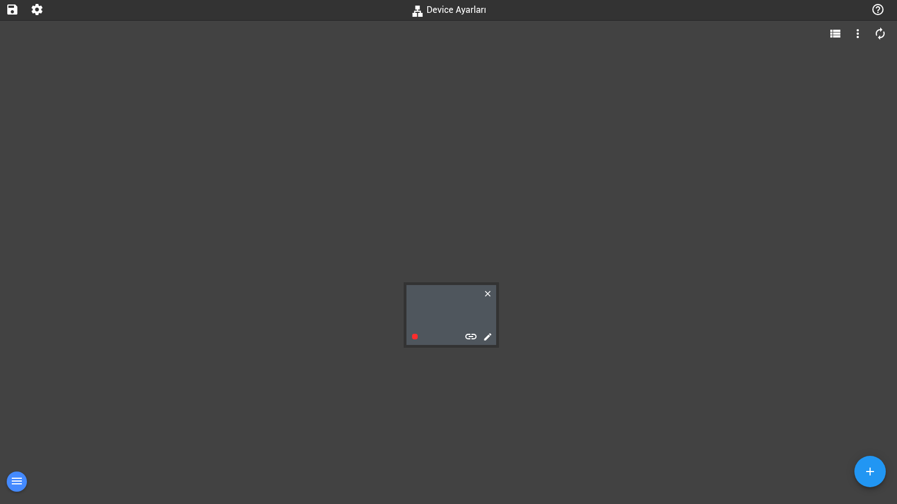
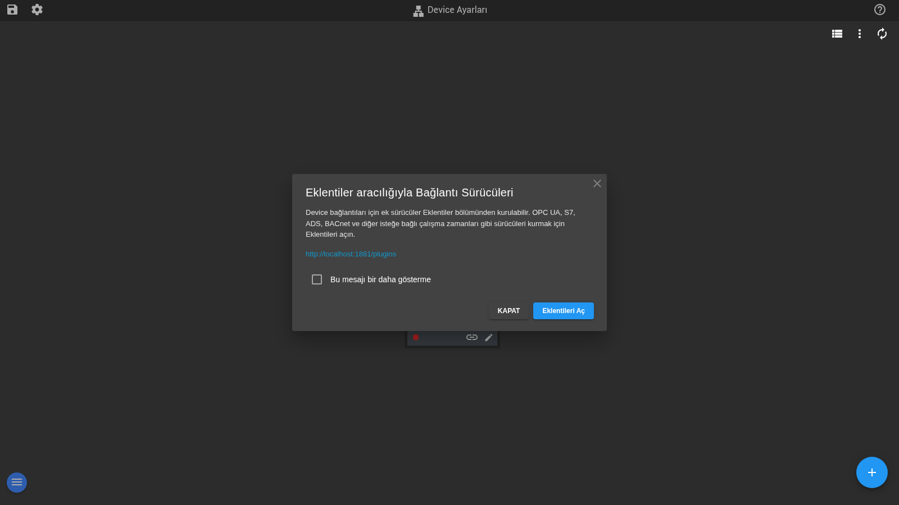
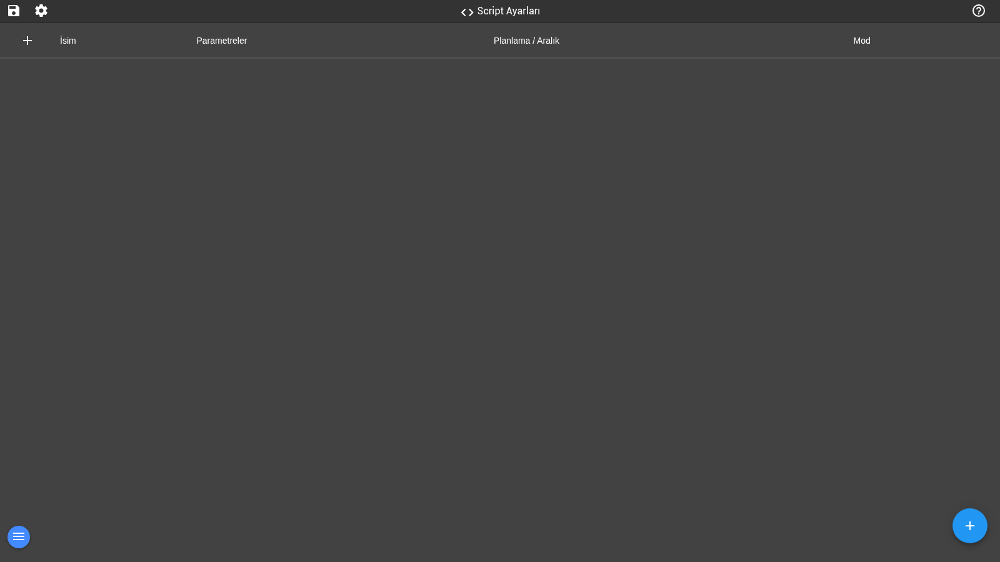

# FUXA — Fabrika Yönetim Sistemi (Türkçe Sürüm)

[](LICENSE)
[](https://nodejs.org/)
[](https://github.com/frangoteam/FUXA)

Bu depo, [FUXA](https://github.com/frangoteam/FUXA) açık kaynak **web tabanlı SCADA/HMI platformunun** tamamen **Türkçeleştirilmiş** sürümünü içerir. FUXA; endüstriyel otomasyon, IoT ve gerçek zamanlı süreç görselleştirme için geliştirilmiş, tarayıcı üzerinden çalışan modern bir izleme ve kontrol yazılımıdır. Bu sürümde arayüzün tamamı Türkçe'ye çevrilmiş, **varsayılan dil Türkçe** yapılmış ve tüm dokümantasyon (README + 24 rehber dokümanı) Türkçe olarak yeniden yazılmıştır.

Endüstriyel terminoloji standardına uygun olarak, sektörel terimler (**Tag, Device, PLC, HMI, DAQ, Polling, Broker, Script, Token** vb.) İngilizce bırakılmış; menüler, düğmeler, iletişim kutuları ve yardım metinleri Türkçe'ye çevrilmiştir. Böylece sahada çalışan mühendis ve teknisyenler için alışılagelen terminoloji korunurken, yazılımın kullanımı Türkçe kullanıcılar için tamamen erişilebilir hâle gelmiştir.

---

## 📸 Ekran Görüntüleri (Türkçe Arayüz)

### İlk Güvenlik Kurulumu Sihirbazı
Uygulama ilk açıldığında karşınıza çıkan güvenlik sihirbazı; kimlik doğrulamayı devre dışı bırakma veya Token ile doğrulama seçeneklerini sunar:



### Görsel Editör (SCADA Tasarım Ekranı)
Editör; sürükle-bırak ile gösterge paneli tasarımı yapmanızı sağlar. Sol panelde **Görünümler, Genel, Kontroller, Şekil, Süreç Mühendisliği, Animasyon, Widget'lar ve Kaynaklar** paletleri bulunur. Örnek görünümde ilerleme göstergesi, giriş alanı, düğme, anahtar, semaför, kaydırıcı ve grafik kontrolü yer alıyor:



### Proje Menüsü
Tüm proje işlemleri Türkçe menülerle sunulur — Yeni Proje, Projeyi Kaydet, Farklı Kaydet, Projeyi Aç, Projeyi Yeniden Adlandır:



### Ana Ekran (Çalışma Zamanı)
Editörde tasarladığınız görünüm, çalışma zamanında Ana Ekranda canlı olarak izlenir. Grafik kontrolü zaman ekseni üzerinde serileri gösterir, kontroller Tag değerleriyle etkileşim kurar:



### Device Ayarları
Cihaz bağlantılarının tanımlandığı sayfa. Modbus RTU/TCP, Siemens S7, OPC-UA, MQTT gibi protokollerle cihaz bağlantıları burada yapılandırılır:



### Eklenti Bildirimi
OPC UA, S7, ADS, BACNet gibi isteğe bağlı bağlantı sürücüleri Eklentiler bölümünden kurulabilir:



### Script Ayarları
Otomasyon scriptlerinin yönetildiği sayfa — İsim, Parametreler, Planlama/Aralık ve Mod kolonlarıyla:



---

## ✨ Özellikler

- **Endüstriyel protokol desteği**
  Modbus RTU/TCP, Siemens S7, OPC-UA, BACnet IP, MQTT, Ethernet/IP (Allen Bradley), ODBC, ADSclient, Gpio (Raspberry), WebCam, MELSEC, Redis
- **Veritabanı ve veri saklama**
  SQLite, InfluxDB ve diğer zaman serisi veritabanlarını destekleyen yerleşik veri tarihçisi (DAQ). ODBC ve Redis ile harici entegrasyonlar.
- **SCADA/HMI Web Editörü**
  Mühendislik ve tasarım tamamen web tabanlı; tarayıcıdan sürükle-bırak ile panel tasarlama.
- **Çapraz platform mimarisi**
  Arka uç: Node.js — Ön yüz: Angular, HTML5, CSS, SVG
- **Alarmlar ve bildirimler**
  Eşik, durum ve sistem alarmları; e-posta/sesli bildirim desteği.
- **Tarifler (Recipe)**
  Üretim parametre setlerini kaydetme, yönetme ve cihazlara tek tıkla indirme.
- **Zamanlayıcı (Scheduler)**
  Zamanlanmış görevler ve takvim bazlı otomasyonlar.
- **Node-RED entegrasyonu**
  Yerleşik Node-RED ile akış tabanlı otomasyon ve FUXA Tag/Cihaz düğümleri.
- **Kullanıcı yönetimi**
  Rol bazlı yetkilendirme, Token ile kimlik doğrulama, API anahtarları.

## Neden FUXA?

FUXA; endüstriyel izleme, SCADA/HMI uygulamaları ve IoT gösterge panelleri için modern, **web tabanlı bir platform** sunar. Standart web teknolojileriyle gerçek zamanlı görselleştirme ve endüstriyel entegrasyonlar oluşturmayı kolaylaştırmak için tasarlanmıştır.

Öne çıkan avantajları:

- Modern **web tabanlı SCADA/HMI mimarisi** — tarayıcı dışında ek kurulum gerektirmez
- Gösterge panelleri ve süreç görselleştirme için görsel editör
- Endüstriyel protokol desteği (Modbus, OPC-UA, MQTT, Siemens S7 ve daha fazlası)
- Modern teknolojilerle geliştirilmiş (Node.js, Angular, SVG)
- **Linux, Windows, macOS, Docker, Raspberry Pi** ve daha fazlasında çalışır
- Açık kaynak ve genişletilebilir

## 🚀 Çalışır Durumda Demo

FUXA editörünün canlı örneğini [buradan](https://frangoteam.github.io) inceleyebilirsiniz. (Demo orijinal İngilizce arayüzdür; bu depodaki sürüm Türkçe'dir.)

## 📚 Dokümantasyon

Bu depodaki tüm dokümanlar **Türkçe'ye çevrilmiştir** ve `docs/` klasöründe yer alır:

| Doküman | İçerik |
|---------|--------|
| [Kurulum ve Çalıştırma](docs/Installing-and-Running.md) | Docker, kaynak koddan ve NPM ile kurulum; ayrıntılı yapılandırma |
| [Cihazlar ve Tag'ler](docs/HowTo-Devices-and-Tags.md) | Device bağlantıları oluşturma, Tag tanımlama, Device şablonları |
| [Kontrolleri Bağlama](docs/HowTo-bind-Controls.md) | Kontrolleri Tag/Device değişkenlerine bağlama |
| [Grafik Kontrolü](docs/HowTo-Chart-Control.md) | Grafik (Chart) kontrolünü yapılandırma |
| [Arayüz Yerleşimi](docs/HowTo-UI-Layout.md) | Header, sidebar ve genel yerleşim ayarları |
| [Alarm Kurulumu](docs/HowTo-setup-Alarms.md) | Alarm tanımlama, yüksek/düşük eşikler, öncelikler |
| [Şekil Tanımlama](docs/HowTo-define-Shapes.md) | Kendi SVG şekillerinizi tanımlama |
| [Boru Animasyonu](docs/HowTo-animate-Pipe.md) | Boru formlarına animasyon ekleme |
| [Zamanlayıcı](docs/HowTo-Scheduler.md) | Zamanlanmış görevler ve takvim otomasyonları |
| [Node-RED](docs/HowTo-Node-Red.md) | Node-RED entegrasyonu, FUXA düğümleri, Dashboard 2 |
| [Projeyi Kaydet/Yükle](docs/HowTo-save-load-Project.md) | Proje dışa/içe aktarma, yedekleme |
| [Olay Yapılandırma](docs/HowTo-configure-events.md) | Olay bazlı aksiyonlar (tık, değişim, düzenli) |
| [Aynı Görünümü Kullanma](docs/HowTo-use-same-view.md) | Birden çok görünümde tek view yeniden kullanımı |
| [Script Yapılandırma](docs/HowTo-configure-Script.md) | Server-side Script'ler, sistem fonksiyonları |
| [Tarifler (Recipe)](docs/HowTo-Recipes.md) | Üretim parametre setleri oluşturma ve yönetme |
| [ODBC](docs/HowTo-ODBC.md) | ODBC ile harici veritabanı bağlantıları |
| [Widget'lar](docs/HowTo-Widgets.md) | Hazır SVG widget kütüphanesi kullanımı |
| [WebSockets](docs/HowTo-WebSockets.md) | WebSocket ile canlı veri entegrasyonu |
| [Ayarlar](docs/Settings.md) | Sunucu ve istemci ayarlarının açıklamaları |
| [İpuçları ve Püf Noktaları](docs/Tips-and-Tricks.md) | Pratik kullanım ipuçları |

Orijinal (İngilizce) resmî dokümantasyon: <https://frangoteam.github.io/FUXA/>

## 🛠 Kurulum ve Çalıştırma

FUXA, arka uçta Node.js, ön yüzde Angular ile geliştirilmiştir. Gereksinim: **Node.js 18 LTS veya üzeri** (Node.js 14 ve öncesi desteklenmez).

### 1. Yöntem — Kaynak koddan çalıştırma (önerilen)

Bu depoyu klonlayın veya indirin, ardından:

```bash
cd server
npm install
npm start
```

Tarayıcıdan (tercihen Chrome) açın: **http://localhost:1881**

Arayüz **doğrudan Türkçe açılır**. İlk çalıştırmada sunucu; proje veritabanı, kullanıcı tanımları ve ayar dosyalarını `server/_appdata` altında otomatik oluşturur. Karşınıza çıkan **İlk Güvenlik Kurulumu** sihirbazında kimlik doğrulamayı yapılandırabilir veya devre dışı bırakabilirsiniz.

> **Not:** Linux sistemlerde (özellikle Raspberry Pi) Node.js 18 ile yerel bağımlılıkların kurulumu ek derleme araçları gerektirebilir. Belirli özellikleri kullanmayacaksanız `server/package.json` dosyasından şu bağımlılıkları güvenle çıkarabilirsiniz: Siemens S7 kullanmıyorsanız `node-snap7`, harici veritabanı bağlantısı kullanmıyorsanız `odbc`.

### 2. Yöntem — Docker ile çalıştırma

```bash
docker pull frangoteam/fuxa:latest
docker run -d -p 1881:1881 frangoteam/fuxa:latest

# Kalıcı veri saklama ile (proje, DAQ geçmişi, loglar ve görseller):
docker run -d -p 1881:1881 \
  -v fuxa_appdata:/usr/src/app/FUXA/server/_appdata \
  -v fuxa_db:/usr/src/app/FUXA/server/_db \
  -v fuxa_logs:/usr/src/app/FUXA/server/_logs \
  -v fuxa_images:/usr/src/app/FUXA/server/_images \
  frangoteam/fuxa:latest

# Docker compose ile:
docker compose up -d
```

> **Docker ile kullanımda not:** Resmî imaj İngilizce gelir. Türkçe arayüz için bu depodaki kaynak koddan çalıştırmanız ya da imajı bu kaynakla yeniden oluşturmanız gerekir.

### 3. Yöntem — NPM ile kurulum

```bash
npm install -g --unsafe-perm @frangoteam/fuxa
fuxa
```

> Bu yöntem resmî (İngilizce) paketi kurar. Türkçe sürüm için 1. yöntemi kullanın.

Kurulumdan sonra tarayıcıdan **http://localhost:1881** adresine gidin.

### İlk Açılışta Ne Yapılır?

1. **Güvenlik sihirbazı**: Kimlik doğrulamayı "Devre dışı" bırakabilir ya da Token ile doğrulamayı seçebilirsiniz.
2. **Editör**: Sol alttaki **Editör** düğmesiyle tasarım ekranına geçin; **Görünümler** panelinden yeni bir görünüm ekleyin.
3. **Kontroller**: **Kontroller** paletinden bir öğe seçip tuvale çizin (gösterge, grafik, düğme, anahtar, kaydırıcı...).
4. **Cihaz ve Tag**: **Device Ayarları**'ndan bir cihaz ekleyin, Tag'leri tanımlayın ve kontrollerinizle bağlayın.
5. **Çalışma zamanı**: **Projeyi Kaydet** ile projeyi kaydedin; **Ana Ekran**'dan canlı izlemeye geçin.

## 🧪 Geliştirme (Full Stack Debug)

Ön yüzü geliştirme modunda çalıştırmak için:

```bash
cd client
npm install
npm start          # http://localhost:4200 (proxy: proxy.conf.json)
```

Sunucuyu ayrı bir terminalde çalıştırın:

```bash
cd server
npm install
npm start
```

VS Code kullanıyorsanız `Debug 'Server & Client'` yapılandırmasıyla her ikisini birlikte hata ayıklama modunda başlatabilirsiniz.

Çeviri dosyası: `client/src/assets/i18n/tr.json` — düzenledikten sonra üretim derlemesi için `npm run build` komutunu kullanın.

## 🏗 Üretim Derlemesi

```bash
cd client
ng build --configuration=production
```

Derleme çıktısı `client/dist` altında oluşur; sunucu bu klasörü otomatik servis eder.

## 🇹🇷 Türkçeleştirme Kapsamı

Bu sürümde yapılan başlıca değişiklikler:

| # | Değişiklik | Dosya(lar) |
|---|-----------|------------|
| 1 | Türkçe çevirisi **625 noktadan düzeltildi/iyileştirildi** (bozuk makine çevirileri, terim tutarsızlıkları, yanlış anlamlar: "İnme"→Çizgi, "Efsane"→Lejant, "Düğüm-KIRMIZI"→Node-RED, "Güneş"→Paz vb.) | `client/src/assets/i18n/tr.json` |
| 2 | Sektörel terim standardı: **Tag, Device, PLC, HMI, DAQ, Polling, Broker, Topic, Payload, Script, Token** İngilizce bırakıldı; menü/butonlar Türkçe | `tr.json` |
| 3 | Kod içine gömülü 2 İngilizce mesaj i18n'e bağlandı | `recipe-editor.component.ts` |
| 4 | **Varsayılan dil Türkçe yapıldı** (ilk açılışta Türkçe açılır; diğer diller menüden seçilebilir) | `server/settings.default.js`, `settings.service.ts`, `settings.ts`, `notification.ts`, `notificator/index.js` |
| 5 | İngilizce `en.json`'a 2 yeni mesaj anahtarı eklendi | `client/src/assets/i18n/en.json` |
| 6 | README ve **24 doküman dosyasının tamamı Türkçe'ye çevrildi** | `docs/*.md`, `mkdocs.yml` |

Doğrulama: `npm install` + `ng build` ile hatasız derlendi; sunucu çalıştırılıp `/api/settings` → `language: "tr"` uçtan uca test edildi.

**Varsayılan dili geri değiştirmek isterseniz:** `server/settings.default.js` içinde `language: 'en'` yapabilir, istemci tarafında `client/src/app/_services/settings.service.ts` içindeki `setDefaultLang`/`use` çağrılarını `'en'` olarak değiştirebilirsiniz.

## Orijinal Proje ve Katkılar

FUXA, [frangoteam](https://github.com/frangoteam) topluluğu tarafından geliştirilen açık kaynak bir projedir. Bu depo, orijinal projenin Türkçe yerelleştirmesini içerir ve MIT lisansı altında aynı koşullarla paylaşılır.

- Orijinal depo: <https://github.com/frangoteam/FUXA>
- Resmî dokümantasyon: <https://frangoteam.github.io/FUXA/>
- Topluluk widget'ları: <https://github.com/frangoteam/FUXA-SVG-Widgets>
- Video eğitimleri: [frangoteam YouTube](https://www.youtube.com/@umbertonocelli5301)

Katkıda bulunmak isterseniz hata bildirimleri ve iyileştirme önerileri için [CONTRIBUTING.md](CONTRIBUTING.md) dosyasına göz atın.

## 📄 Lisans

MIT — ayrıntılar için [LICENSE](LICENSE) dosyasına bakın.
