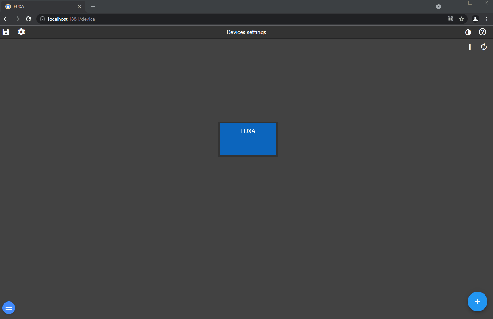
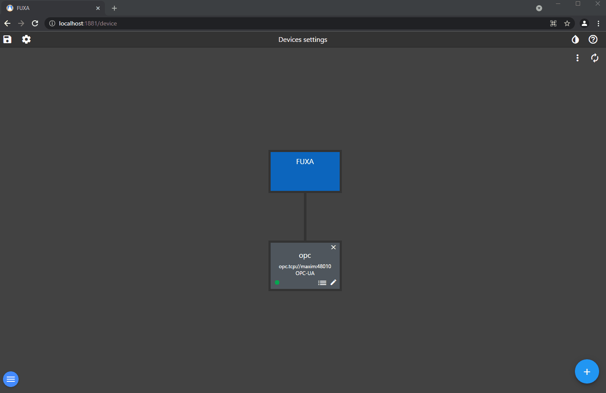
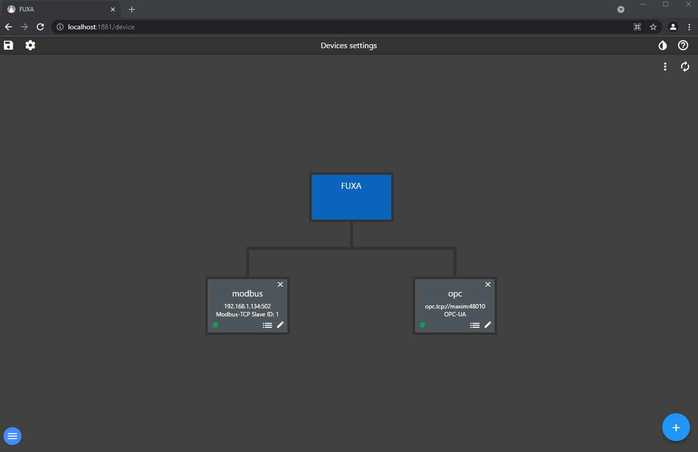
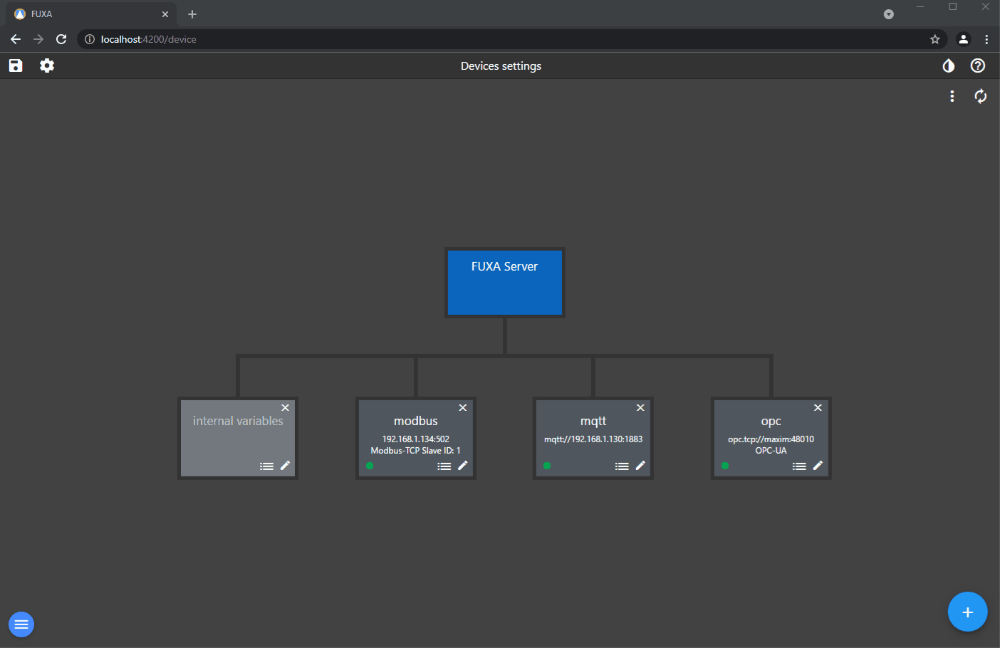

Cihazınızı ve Tag'larınızı eklemek için editörde **Bağlantılar** bölümüne gidin.

Bir **OPCUA** cihazı ekleyin ve bağlayın.

OPCUA Tag'ları eklemek için cihazın bağlı olması gerekir.

Bir **Modbus** bağlantısı eklemek için **Eklentiler** bölümünde sürücüyü kurmanız gerekir.

Bir **MQTT** bağlantısı ve bir konu aboneliği ekleyin

Bir **WebAPI** bağlantısı ve JSON sonucunun bir Tag'ı ekleyin

**Tag Seçenekleri**

Tanımlanmış veri tipine sahip olmayan herhangi bir Tag tipiniz varsa bunu ayarlayabilirsiniz. Örneğin, TIME veri tipi tanımlanmış bir tip değildir, ancak temel veri tipi genellikle int64 veya uint64'tür ve zaman milisaniye cinsindendir.

Tag seçenekleri altında ayrıca ölçek betiğini kullanarak herhangi bir veri tipi dönüşümü vb. yapabilirsiniz. Örneğin, TIME'dan gelen veri LOW ve HIGH dizisidir, bu dizinin elemanını alıp sayı tipi olarak döndüren basit bir betik oluşturabiliriz. Gerekirse yazma için gerçek değeri geri döndürebiliriz.

**Önemli!** Betik parametresi value olarak adlandırılmalıdır, çünkü seçim için ilgili betikleri gösteren bir filtre vardır. Bu betikte yorum satırları kullanmayın, çünkü desteklenmez.

İşte dizinin elemanını döndüren okuma betiği

İşte gerçek Tag değerini döndüren yazma betiği

