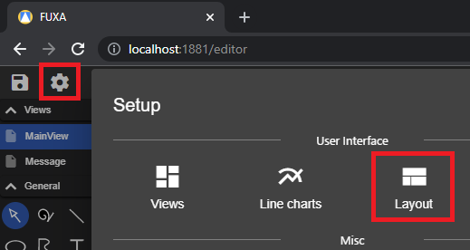
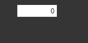
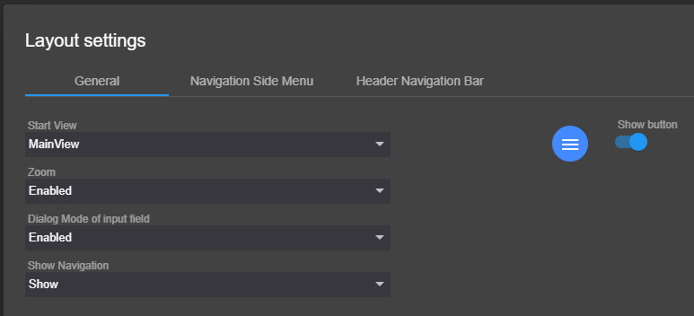
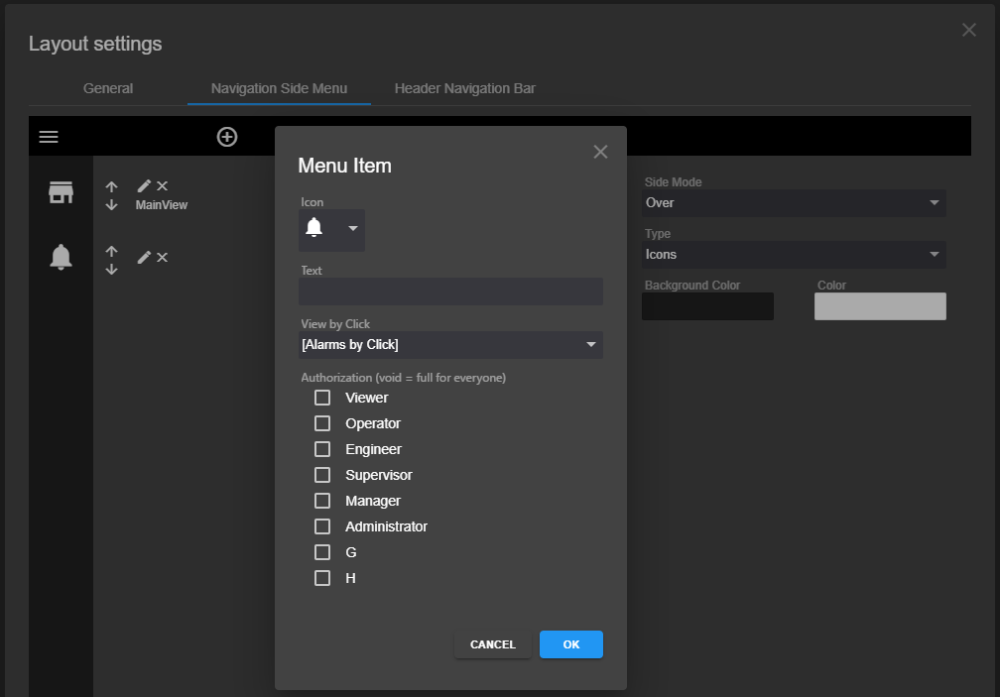
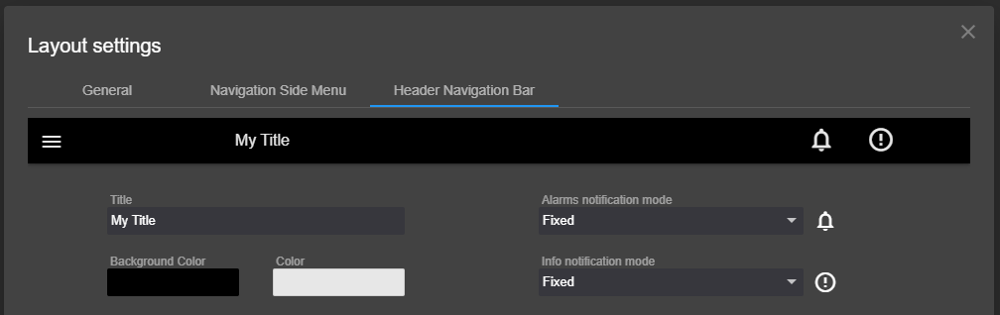

# Düzenleme (Layout) Ayarları

Kullanıcıların düzenini tanımlamak için düzenleyicide **Düzen ayarları**na gidin.

**Genel** sekmesinde şu ayarları yapabilirsiniz:
- **Başlangıç Görünümü**, http://localhost:1881 adresine gidildiğinde gösterilecek ilk Görünüm'dür (ana sayfa).
- **Yakınlaştırma**, etkinleştirilirse Fare Tekerleği ile Görünüm'ü yakınlaştırabilir ve Fare Sol Tuşu ile Görünüm'ü hareket ettirebilirsiniz.
- **Giriş alanı iletişim kutusu modu**, etkinleştirilirse Giriş değeri kontrolü ile bir iletişim kutusu gösterilir.
    - 

- **Gezinme Göster**, Başlık çubuğu ve gezinme Menüsü'nü Göster ve Gizle ayarları.
- Geliştirme düğmesini düzenleme ve ana sayfa arasında geçiş için gizle.

  

**Gezinme Yan Menü** sekmesinde Menü öğelerini ve farklı stil özelliklerini tanımlayabilirsiniz.

**Başlık Gezinme Çubuğu** sekmesinde Alarm bildirim öğelerinin gösterilip gösterilmeyeceğini ve nasıl gösterileceğini ile farklı stil özelliklerini tanımlayabilirsiniz.

