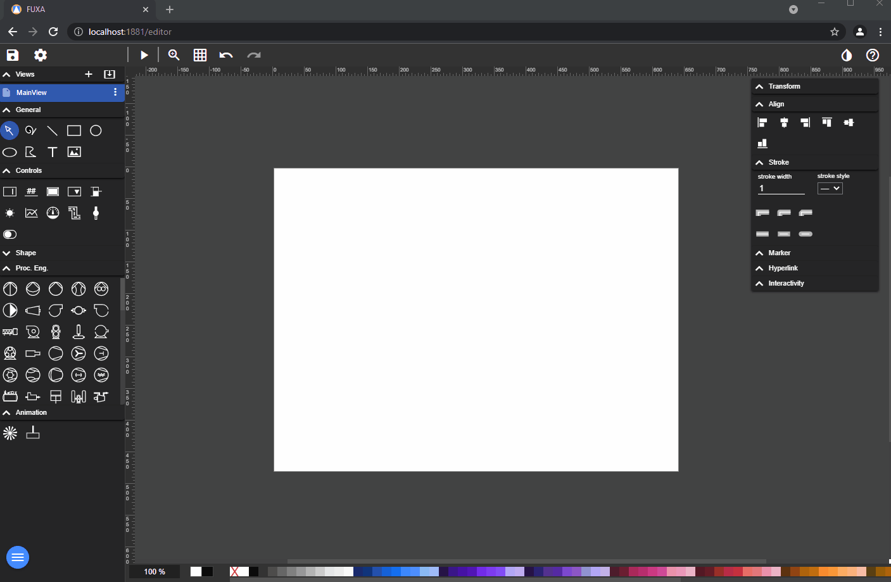
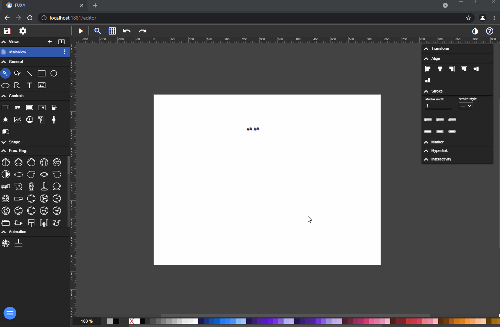
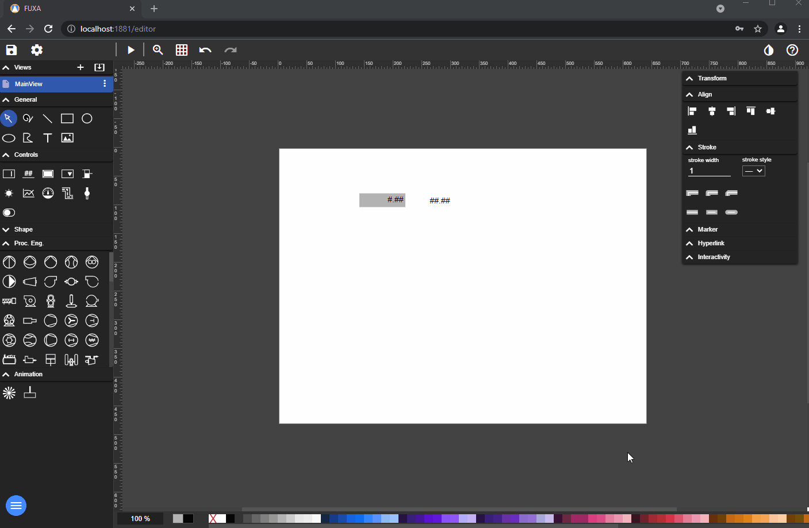
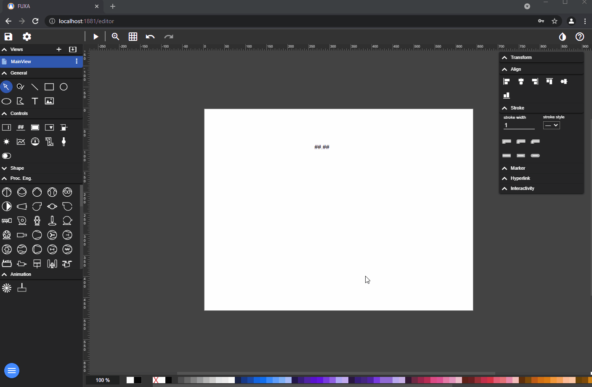

# Bir **Çıkış** Kontrolünü Cihaz Etiketi (Değişkeni) ile Bağlamak için: düzenleyiciye gidin ve Görünüm'ü seçin.

Bir **Giriş** Kontrolünü Cihaz Etiketi ile Bağlamak için.

Bir **Seçim** Kontrolünü Cihaz Etiketi ile Bağlamak için.

Bir **Kaydırıcı** Kontrolünü Cihaz Etiketi ile Bağlamak için.
