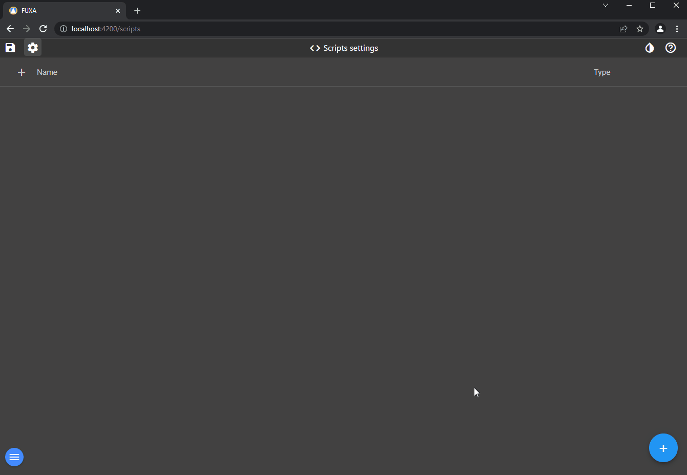
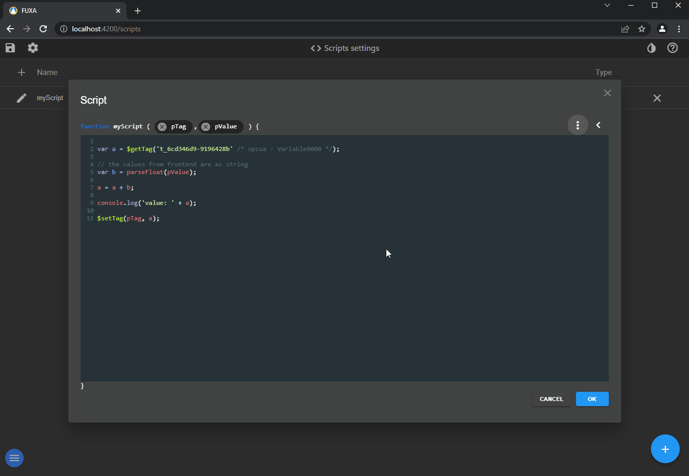

# Betikleri yapılandırmak için düzenleyicideki **Betikler** bölümüne gidin.


Yeni bir betik ekleyin (betik bir javascript fonksiyonudur), fonksiyon adını ve parametreleri yapılandırın, 2 tip parametre vardır:
 - Etiket ID'si
 - Değer, sayı veya metin

Daha sonra mantığınızı fonksiyona yazın. Kullanabileceğiniz sistem çağrıları şunlardır:
 - $setTag, bir Etiketin değerini ayarlamak için
 - $getTag, mevcut Etiket değerini almak için



Betiği test edebilir, console.log metodunu kullanarak bunun mantıklı olup olmadığını doğrulayabilirsiniz.


GUI üzerinden **Olaylar** içinde betiğin çağrısını yapılandırabilirsiniz.



Bir betikte aralıklar (intervals) kullanıyorsanız bunları doğru bir şekilde yönetmeniz önemlidir. Örneğin, bir betikte setInterval kullanıyorsanız ve testi birden çok kez çalıştırırsanız, bu aynı kod parçasını çağıran yeni bir aralık her seferinde oluşturur ve bunu temizlemek için Fuxa'yı yeniden başlatmanız gerekir. Bunu yönetmenin bir yolu, aralığa bir ID atamak ve bunun var olup olmadığını basitçe kontrol etmektir.

```
if (typeof globalThis.myTimer === 'undefined') globalThis.myTimer = null;

if (!globalThis.myTimer) globalThis.myTimer = setInterval(myTimerFunction, 1000);

async function myTimerFunction() {
  //myTimer kodu burada her 1 saniyede bir
}
```