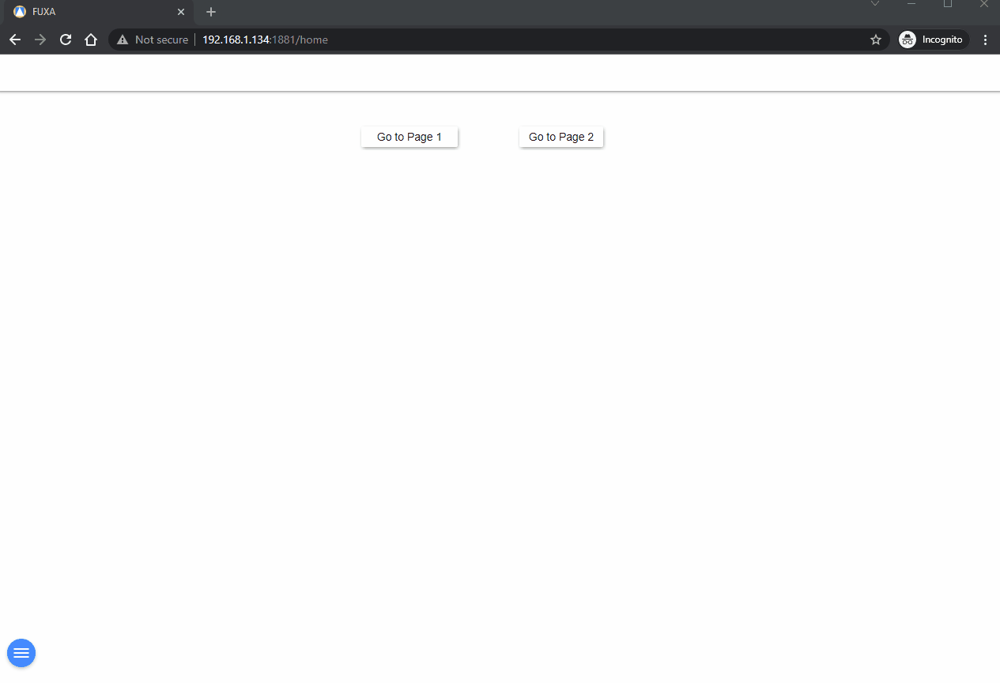
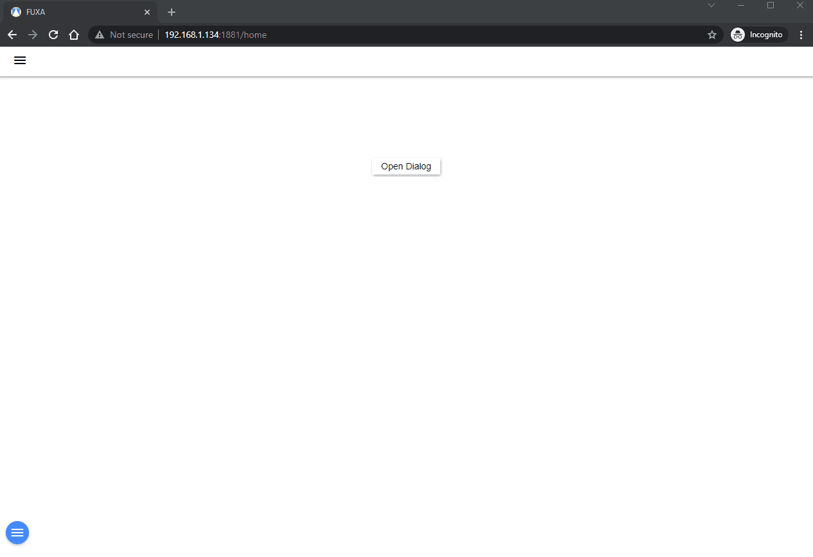
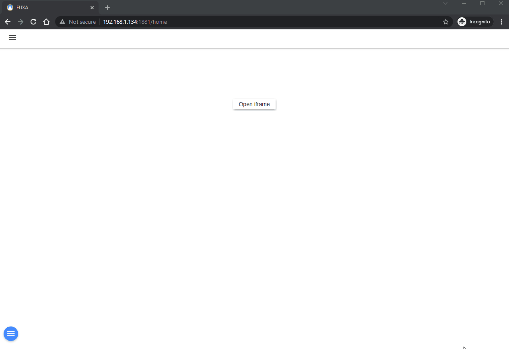
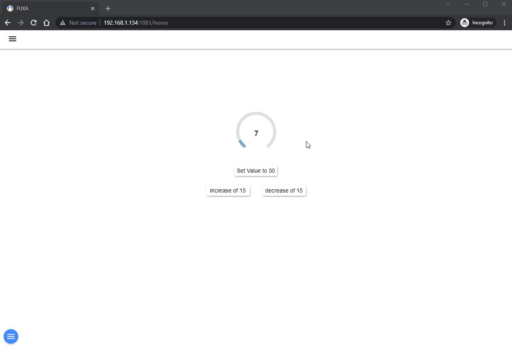
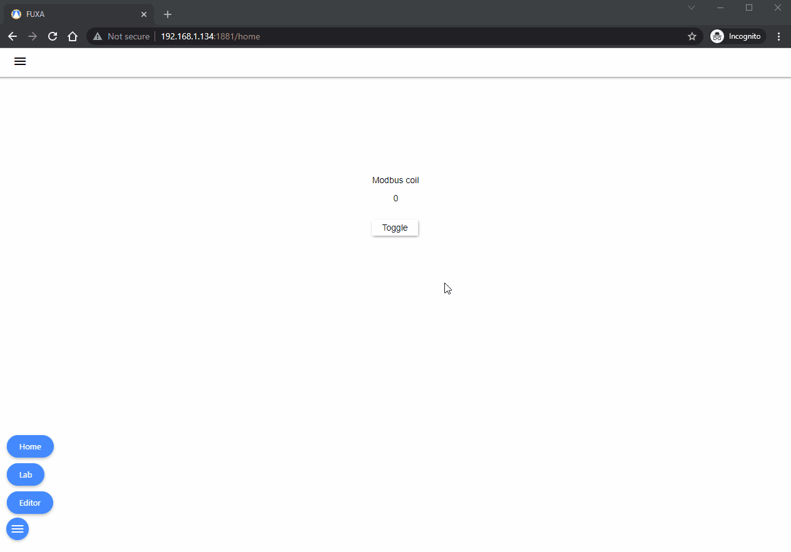

Şekiller ve düğme denetiminde fare **Olayları** olan click, mouseDown, mouseUp görevleri çalıştırmak için yapılandırabilirsiniz.

   - [**Sayfa Aç**](#open-page)
   - [**Kart Aç**](#open-card)
   - [**İletişim Kutusu Aç**](#open-dialog)
   - [**iframe Aç**](#open-iframe)
   - [**Pencere Aç**](#open-window)
   - [**Değer Ayarla**](#set-value)
   - [**Değer Değiştir**](#toggle-value)
   - [**Girişten Ayarla ve Kapat**](#set-from-input-and-close)

## Sayfa Aç

**Ana** pencerede bir Görünüm göstermek için kullanılır.

## Kart Aç

Bir Görünümü açılır pencere olarak göstermek için kullanılır. **Kart**, olay anında fare yanında görünecektir, aynı anda birden fazla kart görüntülenebilir. Aynı **Kart** örneğin daha fazla pompanın değerlerini göstermek için kullanılabilir.

## İletişim Kutusu Aç

Genellikle değerleri yapılandırmak için bir Görünümü iletişim kutusu olarak göstermek için kullanılır. **İletişim Kutusu**, ekranın üzerinde görünecektir. Aynı **İletişim Kutusu** örneğin daha fazla pompanın değerlerini yapılandırmak için kullanılabilir.

## iframe Aç

Bir pencereyi **iframe** (dış kaynaklardan gömülü HTML belgesi) olarak açmak için kullanılır. Pencere boyutunu ve yakınlaştırma ölçeğini tanımlayabilirsiniz.

## Pencere Aç

Yeni bir tarayıcıda bir **pencere** açmak için kullanılır. **Pencere** boyutunu tanımlayabilirsiniz.

## Değer Ayarla

Etiketlerin (Tag) değerini ayarlamak veya mevcut değeri artırmak ve azaltmak için kullanılır.

## Değer Değiştir

Etiketlerin (Tag) değerini 1/0 olarak **değiştirmek** için kullanılır (eğer 1 ise 0 yapar, eğer 0 ise 1 yapar).

## Girişten Ayarla ve Kapat

Bir onay kutusu (OK) iletişim kutusu aracılığıyla bazı değerleri ayarlamak için birleştirilmiş olarak kullanılabilir.

