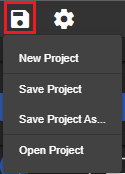

### Proje oluşturma
Yeni bir proje oluşturabilirsiniz, mevcut proje yalnızca boş bir MainView içeren yeni boş proje üzerine yazılacaktır.

### Projeyi kaydetme
Ayarlar her değiştiğinde (iletişim kutuları onayı) 'Cihaz', 'Tag', 'Grafikler' gibi düzenlemeler yapıldıktan sonra proje otomatik olarak dahili veritabanına kaydedilir.

Görünümler başka bir seçildiğinde veya editörden çıkıldığında otomatik olarak kaydedilir.

**Projeyi Kaydet** ile dahili kaydetme işlemini zorlayabilirsiniz.

**Projeyi Farklı Kaydet…** ile tüm projeyi JSON formatında bir dosyaya (MyProject.json) aktarabilirsiniz, bu da projenin yedeğini oluşturmak için kullanışlıdır.

### Projeyi açma
Dışa aktarılmış bir dosyadan (MyProject.json) proje açabilirsiniz.