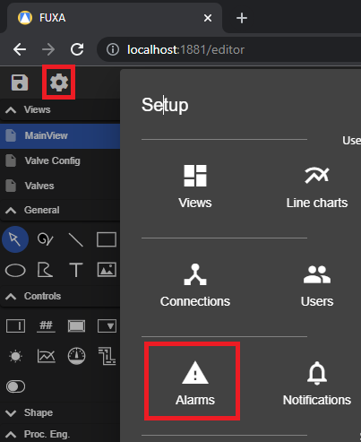
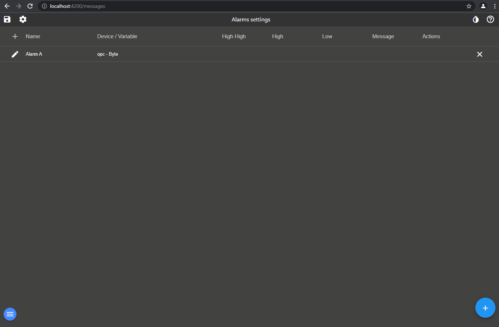
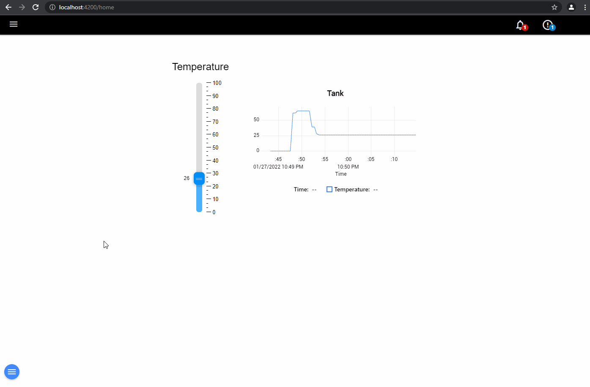
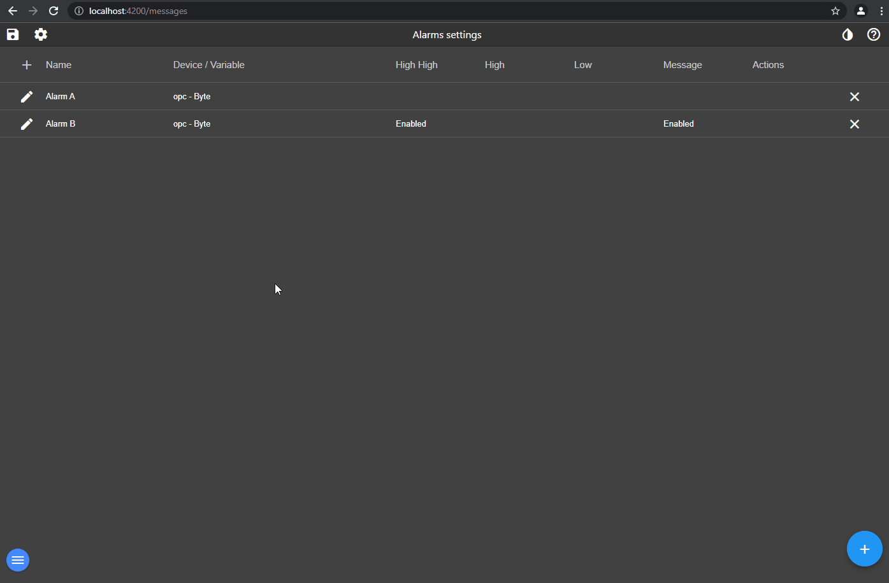

# Düzenleyicideki **Alarm**'ları yapılandırmak için.

Bir alarm, dört tip koşulu (Yüksek Yüksek, Yüksek, Düşük ve Mesaj) ilgili seviyeler için tanımlayabileceğiniz bir Tag'e bağlıdır.

Aktif alarmlar ve geçmiş, menüden veya başlıktaki butondan görünümü yapılandırılarak gösterilebilir. [**Yerleşim ayarları**](https://github.com/frangoteam/FUXA/wiki/HowTo-View-Layout).

Bir alarm için açılır pencere diyalogu gösterme veya bir Tag'e değer atma gibi birden fazla eylem yapılandırmak da mümkündür.

