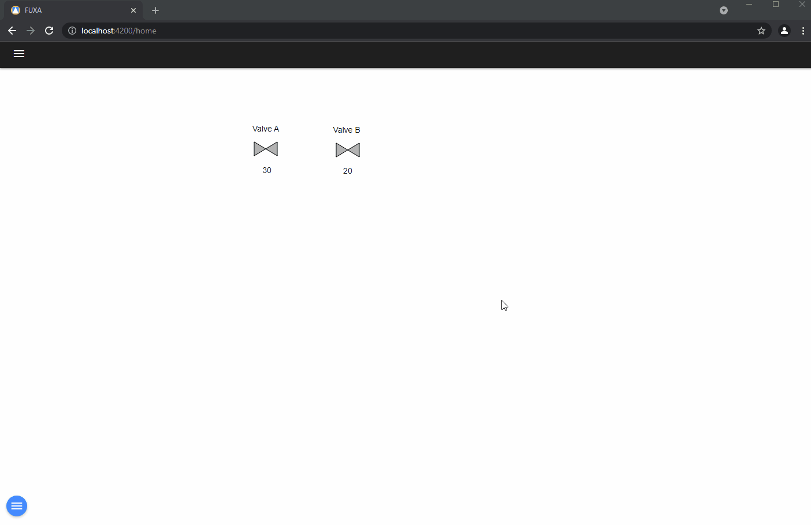
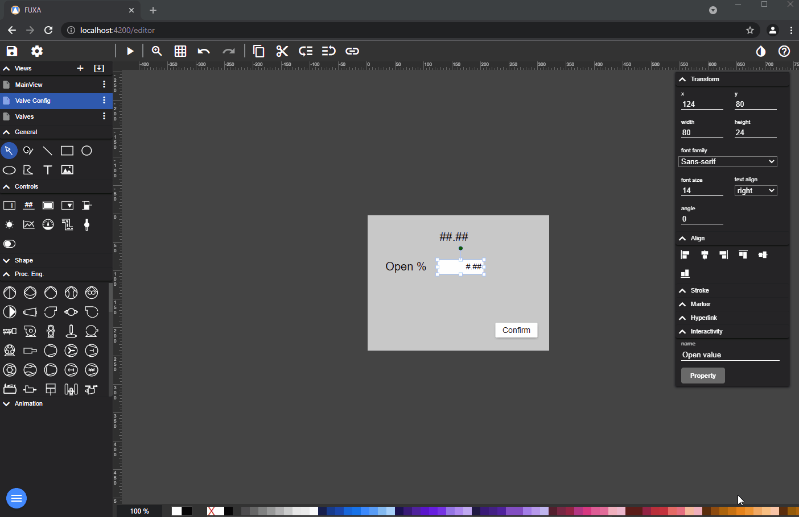
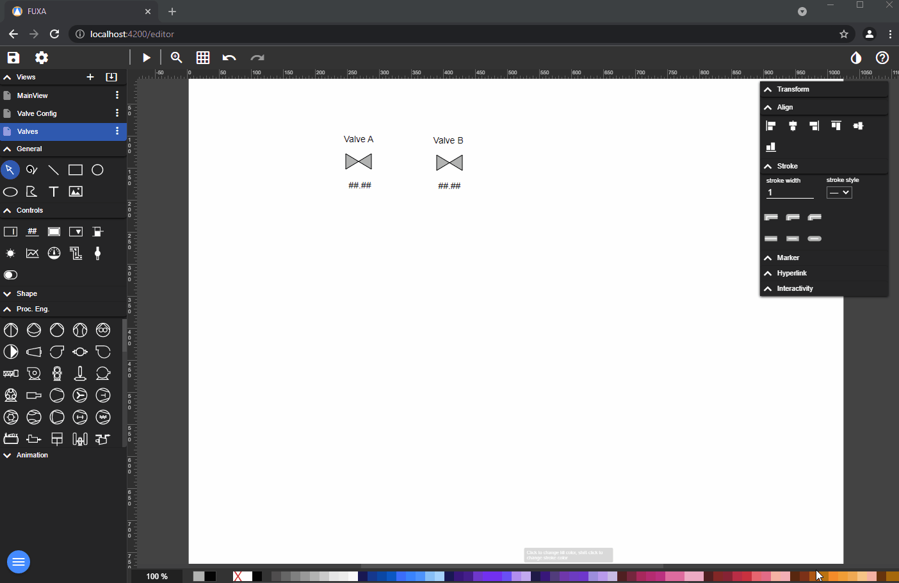
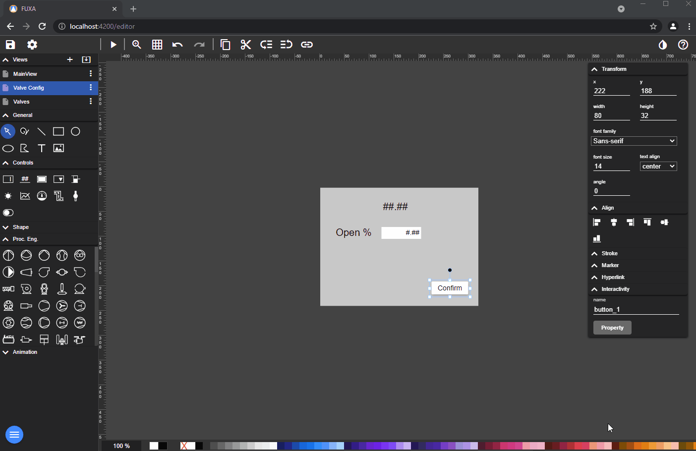
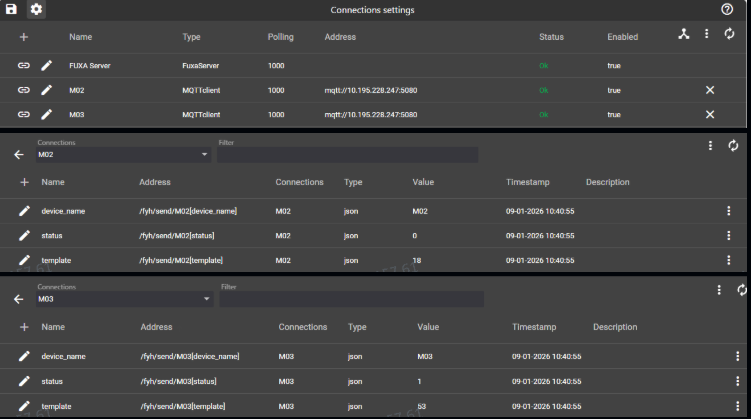
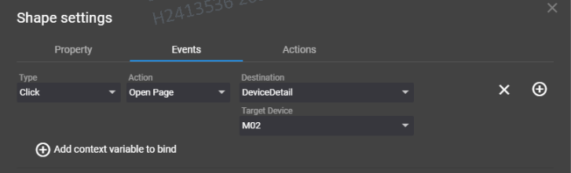
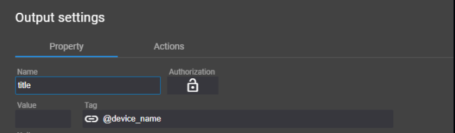
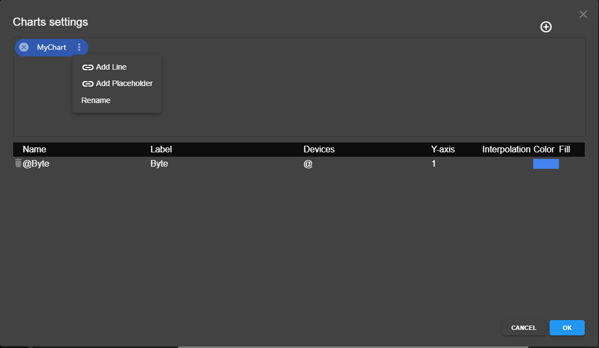
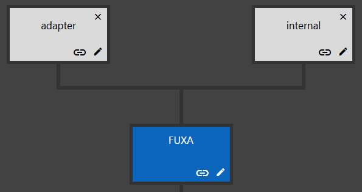
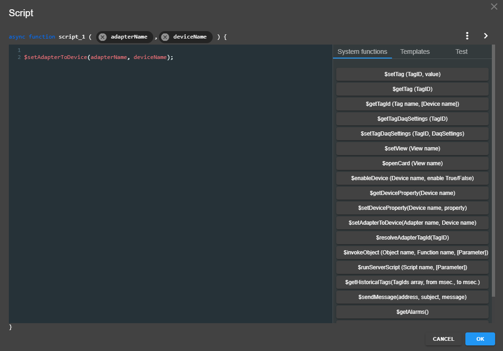

Tekrar eden bileşenler için aynı **Görünüm**'ü tekrar kullanabilirsiniz (örneğin pompalar ve vanalar için).

Bir cihazı **iç** (internal) olarak tanımlamanız ve bazı değişkeni (Tag) yeniden kullanılabilir **Görünüm**'ün kontrollerine bağlamanız gerekir.
Örneğin iletişim kutusu başlığı ve giriş değeri için bir değişken.

Ardından her bileşende iletişim kutusunu açmak için **Olaylar**'ı (Events) tanımlayın, burada iç etiketleri cihaz etiketlerine eşleştirirsiniz.

İstersiniz onay butonu da ekleyebilirsiniz.

## Genişletilmiş Yöntem: Hedef Cihaz ile Paylaşılan Detay Sayfası

Bu özelliğin temel amacı, her cihaz için ayrı detay sayfaları oluşturmadan, aynı türden birden fazla cihazın detaylı verilerini tek bir paylaşılan sayfa şablonu üzerinden dinamik olarak göstermektir.

### Uygulama Adımları

1. Cihaz bağlantıları ve etiketleri oluşturma
**Bağlantılar** (Connections) bölümünde aynı türden iki (veya daha fazla) cihaz bağlantısı oluşturun.
Veri yapısını ve referansları tutarlı tutmak için her cihaz altında tam olarak aynı etiket adlarını kullanın.

2. Görünüm sayfaları oluşturma
İki görünüm oluşturun:
- **Cihaz Listesi Sayfası**: tüm cihazları gösterir ve "Detayları Gör" butonlarını içerir.
- **Cihaz Detay Sayfası**: detaylı cihaz verileri için yeniden kullanılabilir bir şablon.

3. Liste sayfası butonlarında gezinme mantığını yapılandırma
Her "Detayları Gör" butonunda:
- **Hedef Sayfa**: paylaşılan Cihaz Detay Sayfası'nı ayarlayın.
- **Hedef Cihaz**: o buton için belirli cihazı ayarlayın.

4. Detay sayfası şablonunda etiketleri bağlama
Detay sayfasında `@[etiket_adı]` (örnek: `@[cihaz_adı]`) kullanarak değişkenleri bağlayın.
Liste sayfasından Hedef Cihaz ile açıldığında, yer tutucular seçilen cihaz etiketleri karşılaştırılarak çözümlenir.

- Grafik yapılandırması yer tutucuları desteklediği için, grafikler aynı dinamik cihaz-bağlama yaklaşımıyla yeniden kullanılabilir.

Özet:
Bir şablon sayfası birden fazla cihazın detaylarını gösterebilir. Farklı cihaz butonlarına tıklamak, aynı detay sayfasını ilgili gerçek zamanlı verilerle açar.

Referans ve görseller:
- Tartışma #2118: https://github.com/frangoteam/FUXA/discussions/2118

### İç adaptör proxy ile bağlama
UI vekili olarak iç bağlantı adaptörü
Belirli bir cihaza bağlı olmayan, UI bileşenlerine bağlı etiketler oluşturmak için iç bağlantı adaptörleri tanımlayabilirsiniz.
İstemci tarafı betikleri aracılığıyla, çalışma zamanında iç adaptörün hangi gerçek cihazı referans alacağını atayabilirsiniz.
Eşleşen etiket adları olduğunda okuma/yazım işlemleri seçilen cihaza yönlendirilir.

Referans ve görseller:
- Çekme İsteği #1810: https://github.com/frangoteam/FUXA/pull/1810