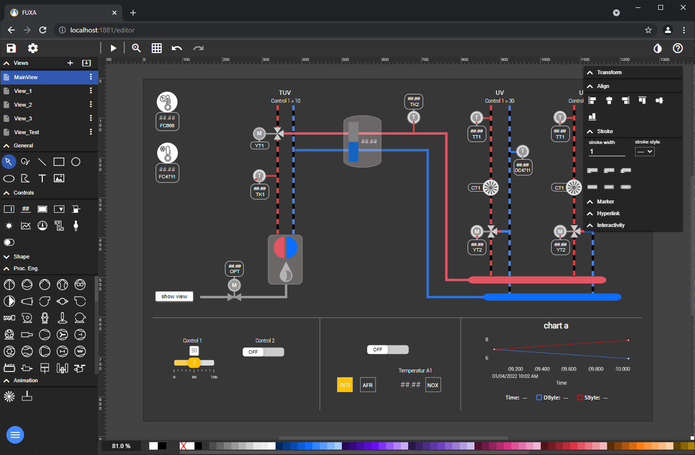
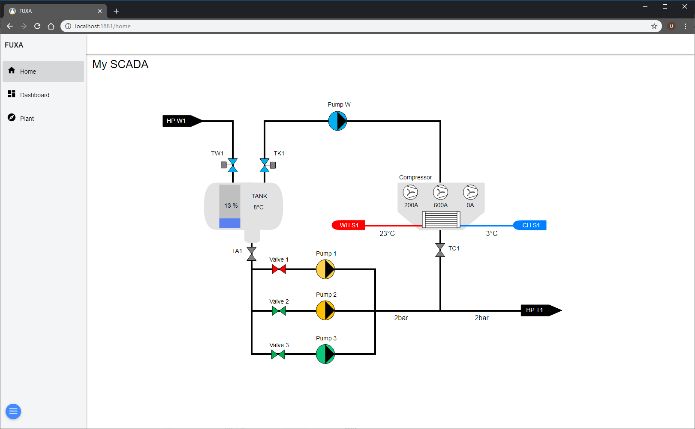

## FUXA wiki'ye hoş geldiniz!

FUXA, ölçeklenebilir SCADA, HMI, Dashboard veya IIoT sistemlerini hızla oluşturmak ve dağıtmak için güçlü bir **web tabanlı** yazılımdır. FUXA ile makineleriniz için bireysel tasarımlarla modern süreç görselleştirmeleri, gerçek zamanlı veri görüntüleme ve otomatikleştirilmiş sanayi tesislerinin kontrol cihazlarını oluşturabilirsiniz.

FUXA, üçüncü taraf OPC sunucularına bağlanmaya olanak tanıyan Siemens S7 protokolü ve OPC UA gibi yaygın kullanılan iletişim standartlarını destekler. Desteklenen iletişim standartları listesi, ek sürücü geliştirerek genişletilebilir.

FUXA'nın yazılım modeli, uygulamanızı (SCADA/HMI/Dashboard) oluşturmak için editöre erişmek ve görselleştirmelerinizi çalıştırmak için bir istemci olarak web tarayıcınızı kullanacağınız Node.js çalışma zamanına dayanır.

## Kullanıcı Arayüzü

FUXA, projeyi düzenlemek için FUXA-editör ve görselleştirme projenizin ürününü göstermek için FUXA-view olmak üzere iki farklı görünümden oluşur.

## Özellikler

FUXA'nın çalışma zamanı lisansı gerektirmez. İstediğiniz sayıda ve boyutta HMI projeleri oluşturabilir ve çalışma ortamının lisanslanması hakkında endişelenmenize gerek kalmaz.

### İletişim Protokolleri
FUXA Platformu, Siemens PLC'leri ve OPC UA veri kaynaklarına doğrudan iletişim kurmak için bağlayıcılar içerir:
- OPC UA bağlantısı için bir istemci.
- Ethernet üzerinden Siemens CPU 200, 300, 400, 1200 ve 1500 ile iletişim kurmak için S7 Protokolü.
- Modbus RTU/TCP, BACnet IP, MQTT, Ethernet/IP (Allen Bradley), WebAPI

### Çapraz Platform Full-Stack
Bu sistem, kolay kurulumla çeşitli işletim sistemlerinde çalışacak şekilde tasarlanmıştır. Backend, NodeJs ile geliştirilmiştir. Kullanıcı arayüzü, ölçeklenebilir bir HTML5 web frontend'dir, web teknolojileri (HTML5, CSS, Javascript, Angular, SVG) ile geliştirilmiş ve tüm modern tarayıcılarla uyumludur.